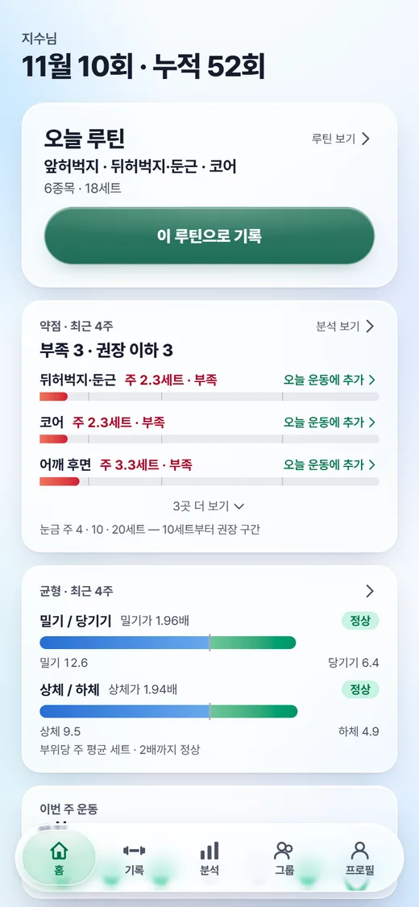
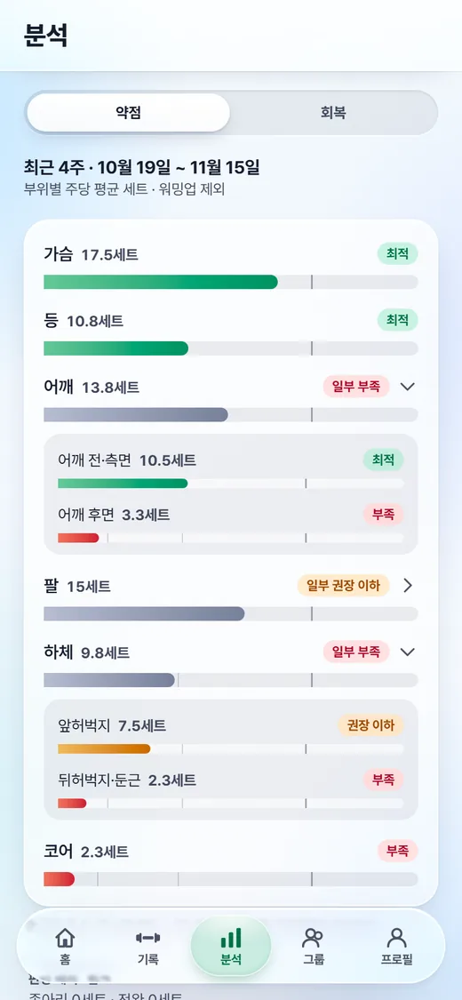
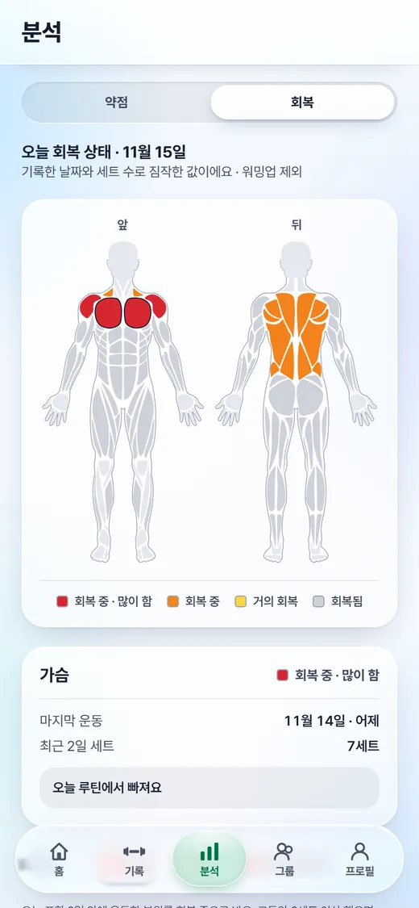
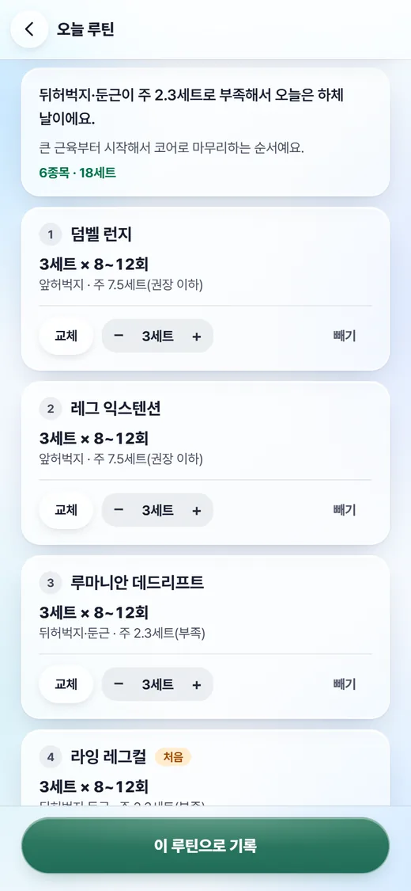
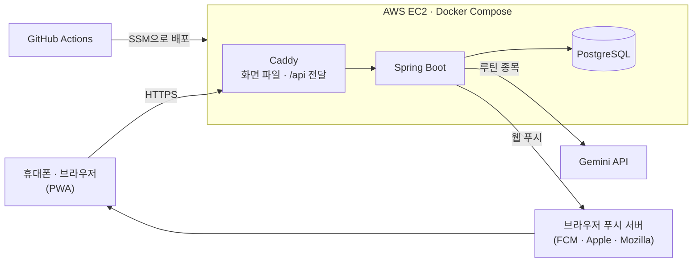

# 밸런스핏 BalanceFit

[](https://github.com/dorominseok/graduation-project/actions/workflows/ci.yml)

**운동 기록으로 부족한 부위를 찾고, 오늘 할 루틴을 짜 주는 헬스 웹앱(PWA)**

기록만 하면 최근 4주 동안 어느 부위를 얼마나 했는지 ACSM 기준으로 판정하고, 회복 상태를 보고 오늘 채울 부위와 세트를 정해 줍니다. 2026년 컴퓨터공학과 졸업작품으로 시작해 지금도 기능을 늘려 가고 있습니다.

🔗 **https://balancefit.duckdns.org** — 휴대폰에서 열고 홈 화면에 추가하면 앱처럼 씁니다

<p align="center">
  
  
  
  
</p>

## 주요 기능

| 기능 | 내용 |
|---|---|
| **운동 기록** | 하루 기록에 세트(무게·횟수·시간)를 체크하며 입력. 지난번 기록을 보며 채우고, 세트 사이 휴식 타이머가 돈다(끝나면 소리·진동, 쉬는 동안 화면 켜 둠). 종목 109종, 동작 그림 포함 |
| **약점 분석** | 최근 4주 부위별 주당 평균 세트로 **부족 · 권장 이하 · 최적 · 과다** 판정. 밀기/당기기 · 상체/하체 균형, 종목별 추정 1RM 추이 |
| **회복 지도** | 앞·뒤 인체 그림에 부위별 회복 상태. 부위를 누르면 마지막 운동일과 오늘 루틴에서 빠지는지 |
| **오늘의 루틴** | 규칙이 오늘 채울 부위와 세트를 정하고, LLM(Gemini)이 종목·순서·설명을 고른다. "왜 오늘 이 부위인지" 한 줄과 함께. 종목 교체 · 세트 조절 · 빼기 |
| **그룹** | 초대 링크로 친구와 그룹을 만들어 서로의 운동 달력을 보고 응원 |
| **알림** | 운동할 요일·시각 리마인더, 주간 요약, 응원 받음, 그룹 소식(웹 푸시). 밤 10시\~아침 8시는 보내지 않음 |
| **기타** | 구글 로그인, 홈 화면 설치, 유리(glass) 테마 색감 6가지 |

## 어떻게 판정하나

**부위별 판정** — 최근 4주 본세트(워밍업 제외)를 주동근 기준으로 세어 주당 평균을 낸다.

| 주당 평균 세트 | 판정 |
|---|---|
| 4 미만 | 부족 |
| 4 이상 10 미만 | 권장 이하 |
| 10 이상 20 이하 | 최적 |
| 20 초과 | 과다 |

10·20은 ACSM 2026 입장문(근육군당 주 10세트 이상, 약 18\~20세트부터 늘어나는 폭 감소), 4는 같은 문헌이 인용한 메타회귀(Pelland 외)의 최소 유효량을 따랐다. 균형은 큰 쪽이 작은 쪽의 2배를 넘으면 경고한다.

**오늘의 루틴** — 부위와 세트는 규칙이, 종목은 LLM이 고른다.

1. 회복 중인 부위(오늘 포함 2일 안에 한 부위)가 든 묶음(하체 · 밀기 · 당기기)은 뺀다
2. 남은 묶음에서 모자란 부위(부족 · 권장 이하) → 불균형의 적은 쪽 → 오래 쉰 부위 순으로 오늘의 묶음을 정한다
3. 하루 18세트, 부위당 주 20세트(과다)를 넘지 않게 세트를 나눈다
4. LLM은 부위별 후보 종목 중에서 고르고 순서와 설명을 붙인다. 응답이 늦거나 규칙에 어긋나면 규칙이 대신 고른다

자세한 근거와 결정은 [문서](#문서)에 있다.

## 기술 스택

| 영역 | 사용 |
|---|---|
| 백엔드 | Java 21, Spring Boot 4.1 (Web MVC, Security, Data JPA, Validation), Flyway, PostgreSQL 16 |
| 인증 | 자체 JWT(액세스는 메모리, 리프레시는 HttpOnly 쿠키 + 회전), 구글 ID 토큰 로그인 |
| 프론트엔드 | React 19, TypeScript 6, Vite 8, React Router 7, CSS Modules, PWA(manifest + 알림 전용 서비스워커) |
| LLM | Google Gemini API — 루틴의 종목·순서·설명만 |
| 알림 | 웹 푸시(VAPID, RFC 8291 암호화) — 라이브러리 없이 JDK와 jjwt로 구현 |
| 인프라 | AWS EC2(서울) 한 대에 Docker Compose(PostgreSQL · 백엔드 · Caddy), HTTPS는 Caddy가 Let's Encrypt로 |
| CI/CD | GitHub Actions — PR마다 테스트, main 머지 시 OIDC + SSM으로 서버에 배포 |



화면과 API가 한 도메인에서 나가서 CORS가 없다.

## 폴더

```
backend/     Spring Boot — 도메인별 패키지(auth, workout, analysis, routine, group, notification …)
frontend/    React + Vite — screens/(화면), api/(API 호출), app/(라우터·알림), sw.ts(서비스워커)
deploy/      운영 구성 — compose.yml, Caddyfile, 배포·백업 스크립트
docs/        설계 문서
scripts/     종목 데이터·그림 생성 스크립트
docker-compose.yml   로컬 개발용 PostgreSQL
```

## 로컬에서 실행

필요한 것: Java 21, Node.js 24, Docker

```bash
# 1. DB
cp .env.example .env          # POSTGRES_PASSWORD=devpassword123 (백엔드 기본값과 같게)
docker compose up -d

# 2. 백엔드 — http://localhost:8080/actuator/health 가 UP이면 DB까지 연결된 것
cd backend
./gradlew bootRun

# 3. 프론트엔드 — http://localhost:5173 (/api는 Vite가 8080으로 넘긴다)
cd frontend
npm install
npm run dev
```

아래는 넣지 않아도 앱은 돈다. 켜고 싶은 것만 백엔드 실행 전에 환경변수로 준다.

| 환경변수 | 없으면 | 넣는 법 |
|---|---|---|
| `LLM_ENABLED=true`, `GEMINI_API_KEY` | 규칙이 루틴 종목까지 고른다 | Google AI Studio에서 키 발급 |
| `VAPID_PUBLIC_KEY`, `VAPID_PRIVATE_KEY` | 알림을 보내지 않는다(설정 화면에서 켜기가 막힘) | `cd backend && ./gradlew vapidKeys` |
| `DB_URL`, `DB_USERNAME`, `DB_PASSWORD` | 로컬 기본값(`localhost:5432/fitness`, `fitness`, `devpassword123`) | `.env`를 기본값과 다르게 했을 때만 |

**테스트**

```bash
cd backend && ./gradlew test          # DB가 떠 있어야 한다 — 실제 PostgreSQL로 돈다
cd frontend && npm run lint && npm run build
```

API 문서(Swagger UI)는 로컬에서 `http://localhost:8080/swagger-ui.html`, 손으로 쓴 명세는 [docs/API_명세서.md](docs/API_명세서.md).

## 배포

main에 머지하면 CI가 테스트를 통과한 뒤 자동으로 올린다. `backend/` · `frontend/` · `deploy/`가 바뀐 커밋만 배포하고, 끝나면 `/actuator/health`를 확인한다. 같은 커밋을 다시 올리려면 Actions → Deploy → Run workflow.

<details>
<summary>서버 처음 준비하기</summary>

서버(Ubuntu 24.04)에 접속해서:

```bash
git clone https://github.com/dorominseok/graduation-project.git
cd graduation-project
bash deploy/setup-server.sh        # 스왑 2GB, Docker. 처음이면 끝난 뒤 다시 접속
cd deploy
cp .env.example .env               # DOMAIN, POSTGRES_PASSWORD, JWT_SECRET(openssl rand -base64 32)
                                   # 선택: LLM_ENABLED·GEMINI_API_KEY, VAPID_PUBLIC_KEY·VAPID_PRIVATE_KEY
docker compose up -d --build
```

도메인이 서버를 가리키고 80·443이 열려 있으면 Caddy가 인증서를 받아 온다. 백업은 crontab에 등록한다(7일치 보관):

```
0 4 * * * /home/ubuntu/graduation-project/deploy/backup.sh >> /home/ubuntu/backups/backup.log 2>&1
```

자동 배포가 안 될 때는 서버에서 `git pull && bash deploy/update.sh`. `.env`만 바꿨으면 `docker compose up -d backend`.

DB와 인증서는 볼륨에 남는다. `docker compose down -v`는 볼륨까지 지우므로 운영 서버에서 쓰지 않는다.

</details>

## 문서

| 문서 | 내용 |
|---|---|
| [운동_분석로직_설계서](docs/운동_분석로직_설계서.md) | 세트 세는 법, 판정 구간과 근거, 균형 판정 |
| [루틴생성_로직_설계서](docs/루틴생성_로직_설계서.md) | 오늘의 묶음·부위·세트 규칙, LLM에 맡기는 범위, 이유 문장 |
| [LLM_연동_실험기록](docs/LLM_연동_실험기록.md) | 프롬프트·모델 실험과 결과 |
| [회복지도_설계서](docs/회복지도_설계서.md) | 회복 상태 계산, 인체 그림 |
| [알림_설계서](docs/알림_설계서.md) | 알림 종류, 보내는 규칙, 서비스워커 |
| [운동기록_방식_설계서](docs/운동기록_방식_설계서.md) | 하루 기록, 세트 입력, 휴식 타이머 |
| [API_명세서](docs/API_명세서.md) | 엔드포인트 전체 |
| [설계변경_로그](docs/설계변경_로그.md) | 졸업작품 기간의 결정 기록(LOG-01\~46, 동결) |

## 출처

- 인체 그림: [react-muscle-highlighter](https://github.com/soroojshehryar/react-muscle-highlighter) 1.2.0 (MIT)의 SVG 경로
- 종목 동작 그림: [everkinetic](https://github.com/everkinetic/data) (CC BY-SA 4.0), [free-exercise-db](https://github.com/yuhonas/free-exercise-db) (Unlicense) — 크기만 줄여 webp로
- 글꼴: [Pretendard](https://github.com/orioncactus/pretendard) (SIL OFL 1.1)

앱 안 설정 › 오픈소스 라이선스에 원문이 있다. 개인정보처리방침은 [/privacy](https://balancefit.duckdns.org/privacy).
